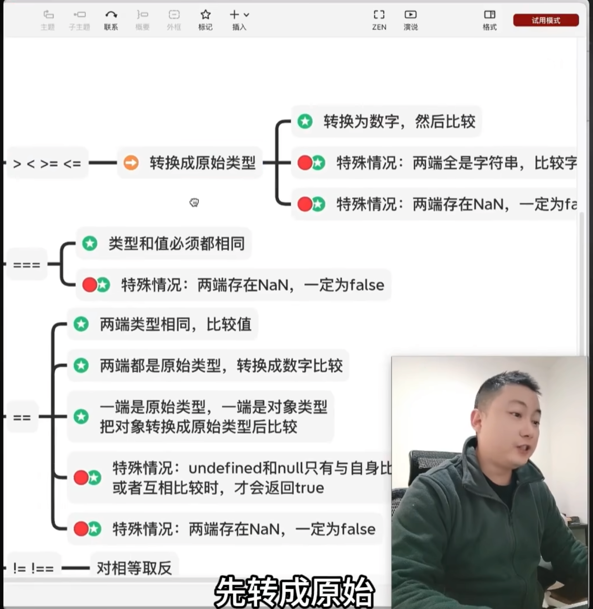
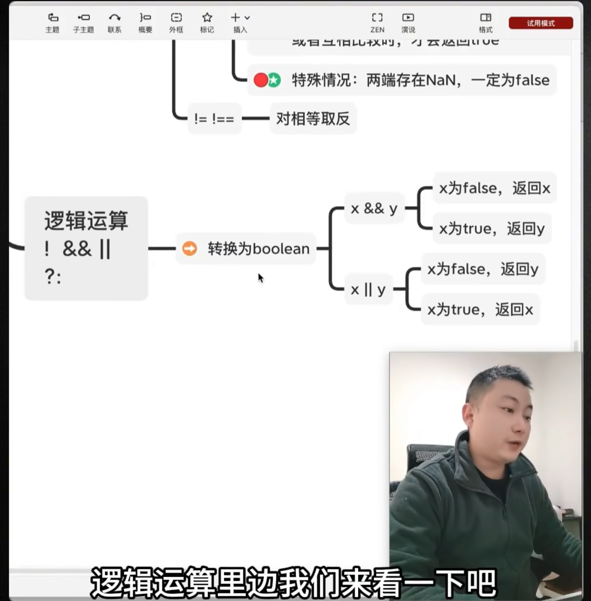

### 类型转换规则
原始 -> 数字: true->,false->0,null->0, undefined->NaN, string: 空字符串(含空白字符)-》0 去掉引号,不是数字就是NaN
所有 -> bool: null->false,undefined->false,number: 0->false, 其它-》true, NaN->false,string: 空字符串-〉false,其它-》true,对象-〉true
原始 -> 字符串: null->'null', undefined->'undefined',number->“数字”,boolean: true->"true", false->"false"
对象 -> 原始: 调用valueOf -> 得到的是对象?重新调用toString -> 得到的还是对象? 报错

### 运算规则

### 表达式
数据: 字面量、变量、表达式、返回值
