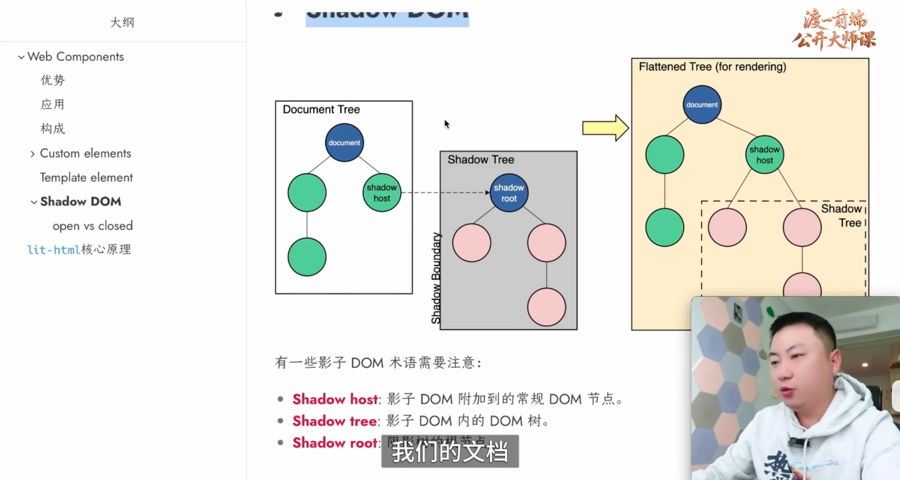
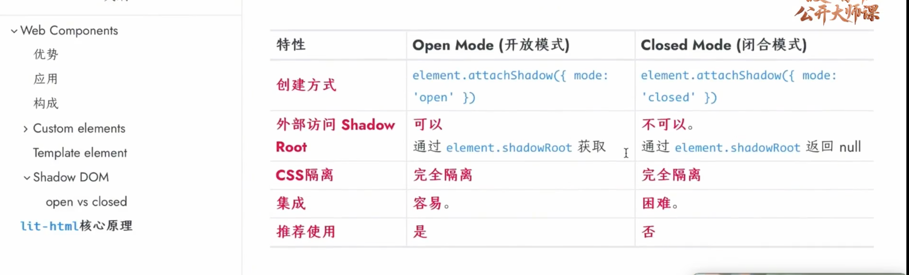

 ### Shadow DOM
 影子DOM术语
 1、Shadow host: 影子DOM附加到的常规DOM节点
 2、Shadow tree: 影子DOM内的DOM树
 3、Shadow root: 影子树的根节点



```
<!-- ShadowDom实现 -->
const isolationDiv = document.querySelector('.isolation');
<!-- mode: open为外部dom可得到shadowDom内部数据,closed则不可以拿到内部数据 -->
isolationDiv.attachShadow({ mode: 'open' })
isolationDiv.shadowRoot.innerHTML = `
    <style>
        p {
            text-decoration: dashed underline;
        }
    </style>
    <p>isolation</p>
`
```


### 插槽
```
<!-- 书写形式 -->
<slot name='default'></slot>
```
修改插槽内部样式(只能指定简单类、属性、id选择器)
```
::slotted(span) {
    color: red;
}
```

### 自定义事件
```
<!-- 注册事件 -->
const e = new CustomEvent('change', {
    detail: {checked: false}
})
window.addEventListener('change', e => {
    console.log('change event', e);
})

<!-- 派发事件 -->
window.dispatch(e)
```