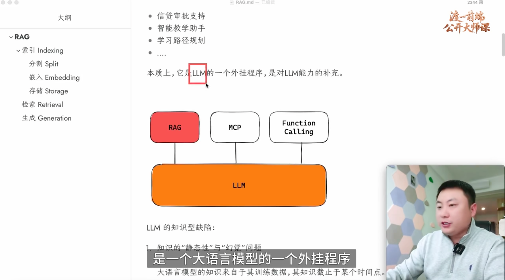
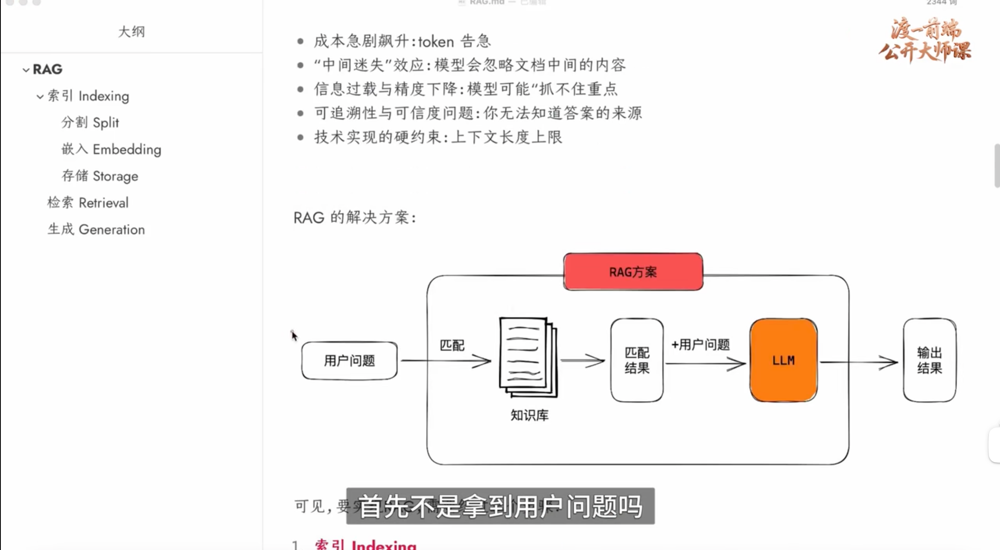

### 简介
RAG全称: 检索增强生成,被大量应用于基于AI的专业型知识场景
比如: 智能企业知识库、智能客服、竞品分析等等
本质上,它是LLM的一个外挂程序,是对LLM能力的补充

### LLM知识型缺陷
1、知识的静态性和幻觉问题
2、领域知识的专业性与深度不足问题
3、信息的溯源和可信度问题

### 实现RAG的步骤
1、索引Indexing: 需要将知识库以某种格式保存起来,方便后续匹配
2、检索Retrieval: 需要将用户的问题与之前建立的索引进行匹配,得到相关度较高的结果
3、生成Generation: 将匹配的知识和用户问题混合投递给LLM,从而得到准确的结果