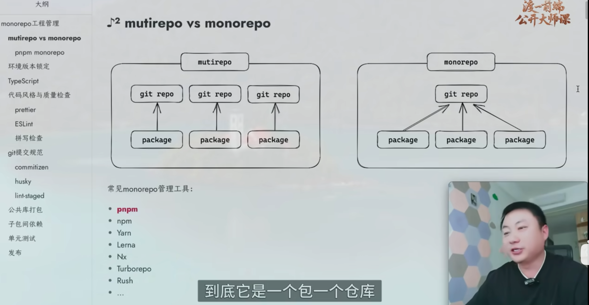

### 前端工程化流程
1、遇到问题
2、解决方案
3、技术选型
4、技术实施
5、呈现效果

SaaS
业务: 前端、后端
基建: 组件库、函数库、脚手架、低码

### mutirepo和monorepo区别



### ESLint 
```
<!-- 安装命令 -->
pnpm -Dw add eslint@latest @eslint/js globals typescript-eslint eslint-plugin-prettier eslint-config-prettier eslint-plugin-vue
```
类别            库名
核心引擎            eslint@latest
官方规则集           @eslint/js
全局变量支持         globals
TypeScript 支持     typescript-eslint
Prettier 集成       eslint-plugin-prettier eslint-config-prettier
Vue.js 支持         eslint-plugin-vue
类型定义             @types/node

配置
```
<!-- 生成 eslint.config.js 配置文件 -->
touch eslint.config.js 
<!-- eslint脚本检查命令 -->
"lint:eslint": "eslint \"**/*.{js,jsx,ts,tsx}\""
```

### 拼写检查
VS Code 插件: Code Spell Checker
```
<!-- 安装命令 -->
pnpm -Dw add cspell @cspell/dict-lorem-ipsum
<!-- 生成cspell.json 配置文件 -->
touch cspell.json
<!-- 拼写检查脚本 -->
lint:spellcheck: "cspell lint \"**/*.{js,jsx,ts,tsx,md,vue}\""
```

### git提交规范
```
<!-- git仓库创建 -->
touch .gitignore
```
commitizen
<!-- 安装命令 -->
pnpm -Dw add @commitlint/cli @commitlint/config-conventional commitizen cz-git
@commitlint/cli 是commitlint工具的核心
@commitlint/config-conventional 是commitlint的默认配置
commitizen 是一个用于规范git提交信息的工具
cz-git 是commitizen的一个适配器，用于在git提交时使用cz-git的交互式界面

配置命令
//package.json
"scripts": {
    "commit": "cz-git"
},
"config": {
    "commitizen": {
        "path": "node_modules/cz-git"
    }
}
配置cz-git
touch commitlint.config.js

husky
安装husky
pnpm -Dw add husky
初始化
pnpx husky init
配置
#!/usr/bin/env sh
pnpm lint:prettier && pnpm lint:eslint && pnpm lint:spellcheck

lint-staged
安装
pnpm -Dw add lint-staged
配置命令
“precommit”: "lint-staged"
配置文件
// .lintstagedrc.js
export default {
    "*.{js,ts,mjs,cjs,json,tsx,css,less,scss,vue,html,md}": ["cspell lint"],
    "*.{js,ts,vue,md}": ["prettier --write", "eslint"]
}
