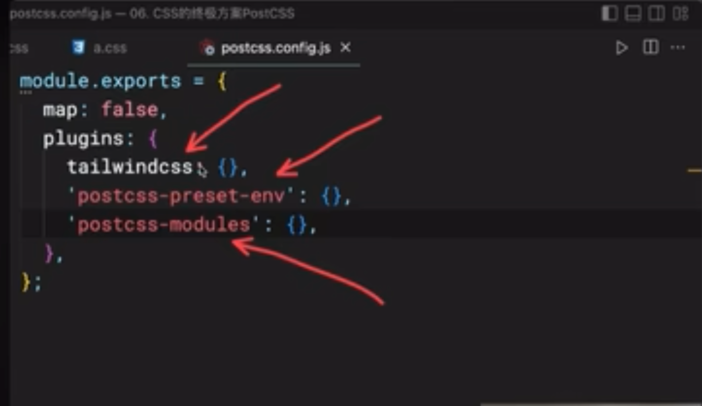
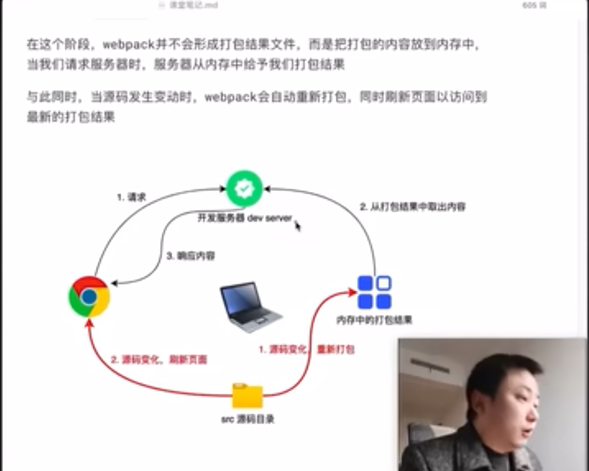

### 工程化出现的原因
项目规模逐渐变大,需要越来越多的知识和体系来构建

### 全局污染问题
随着JS文件数量和代码量的增加,全局变量同名的几率将会陡然上升,开发人员不得不耗费大量的精力来规避

### 依赖混乱的问题
如何规划JS的引入顺序

### 模块化
1、解决全局污染问题
2、解决依赖混乱问题
官方标准: ES Module
社区标准: CommonJs、AMD、CMD、UMD
原理: 把每个JS文件看做是一个模块,每个模块可以有自己的内部实现,也可以导出某些功能供外部使用
现象:
1、各种第三方库层出不穷的涌现
2、模块化的出现实现了前端崛起
3、每个第三方库解决前端一部分问题

 ### 包管理
定义: 包是模块的集合,用于解决某一方面的问题,一个三方库可以看做是一个包
包管理器: 解决各种第三方库的管理问题
官方包管理器: npm
社区包管理器: yarn、pnpm、cnpm

### 前端工具链
1、eslint-代码风格管理器
2、Babel-js兼容性编译器
3、css预编译器: sass、less、stylus
4、PostCSS: 解析源代码,将最终结果转换为CSS文本

### 构建工具
主流工具: webpack、vite
webpack核心功能:
1、打包压缩混淆
2、文件指纹
3、开发服务器

### 工程化学习路线
1、模块化: CommonJs、ES Module
2、包管理: npm、yarn、pnmp
3、构建工具: webpack(概念、原理、配置、扩展、优化)、vite(rollup、esbuild)
4、脚手架: vue-cli、create-react-app