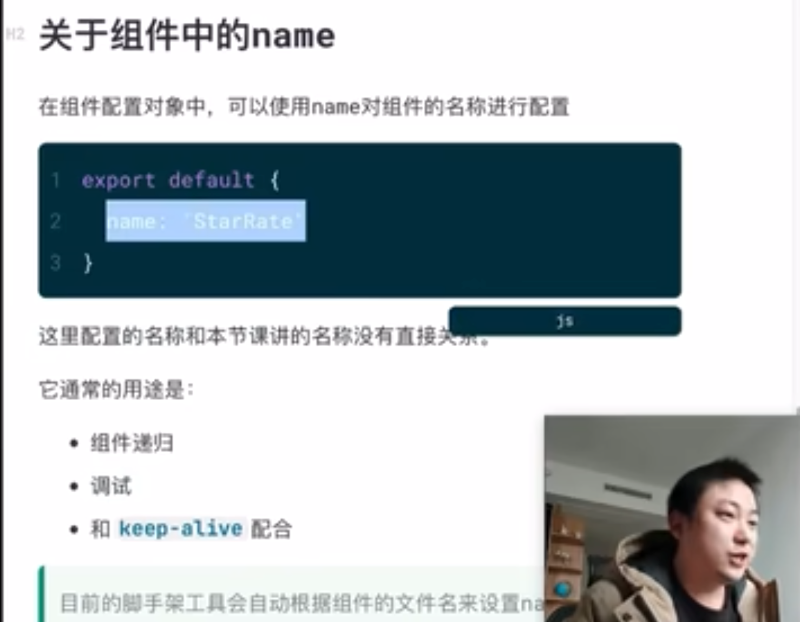

### 组件出现的原因
1、开发单元过大
2、重复区域难以抽离
定义: 组件是从UI中抽离出来的一块区域
意义:
1、降低了开发粒度,从而降低了整体复杂度
2、减少了重复代码,提升了开发效率和可维护性
3、更利于团队协作
4、更容易抽离为公共库

### SFC-单文件组件
vue: .vue文件,包括template(书写HTML)、script(书写JS)、style(书写css)标签


### 组件全局注册和局部注册
1、Vue组件全局注册
mport MyComponent from './components/MyComponent';

Vue.component('my-component', MyComponent)

2、Vue组件局部注册
import MyComponent from './components/MyComponent';

export default {
    components: {
        MyComponent
    },
    data() {
        return {

        }
    }
}


### 关于组件中的name
定义: 在组件配置对象中,可以使用name对组件的名称进行配置
```
export default {
    name: 'StarRate'
}
```
通常用途:
1、组件递归
2、调试
3、和keep-alive配合


### vue组件data属性使用函数的原因
保持组件数据独立

### 单向数据流
在vue、react中数据一般只能从父组件向子组件单向流动

### Vue知识体系
入门-》组件 -〉模板语法进阶 -》生态 -〉Vue3 -》笔面试