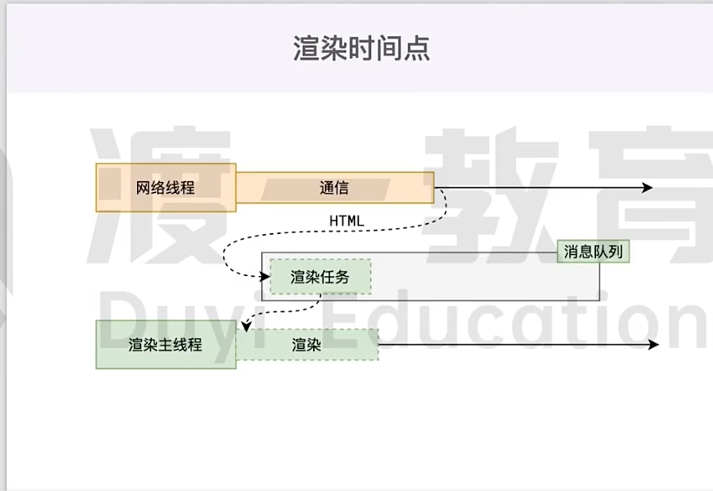
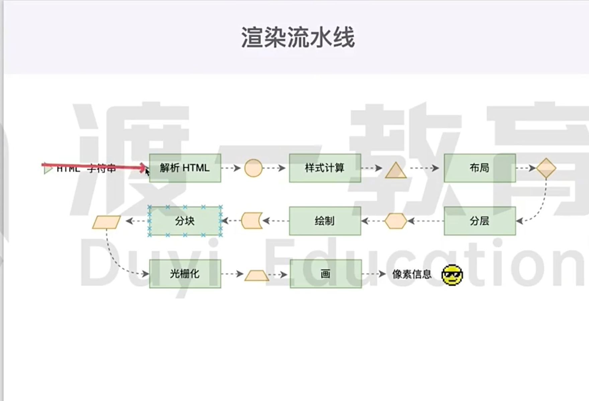
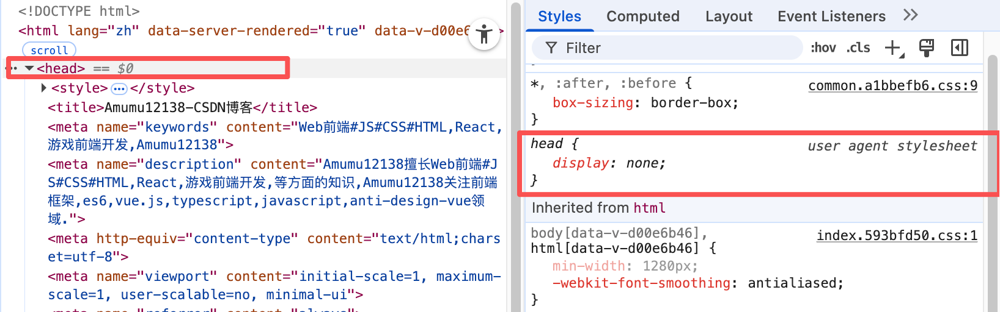
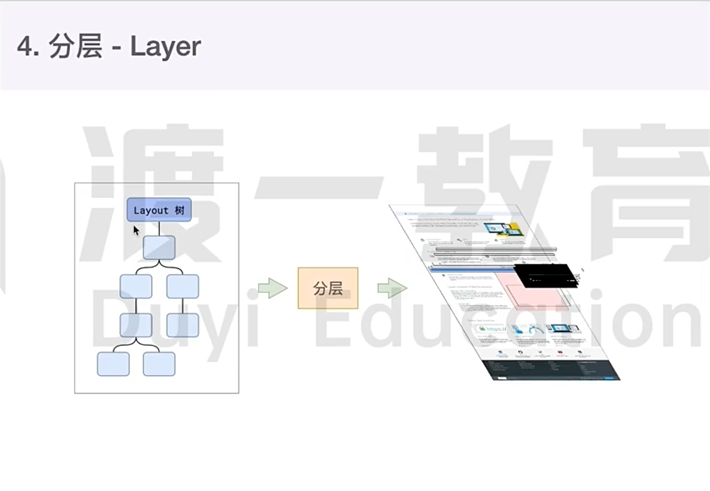
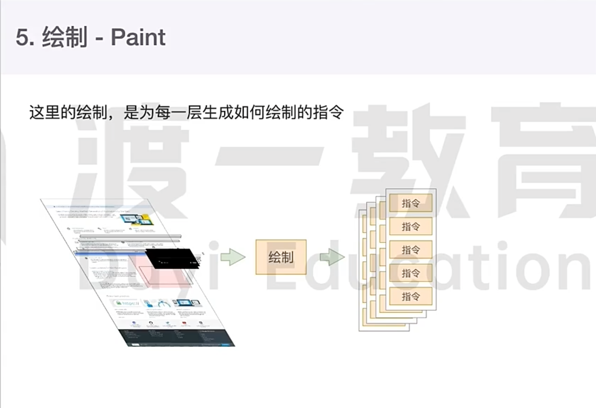
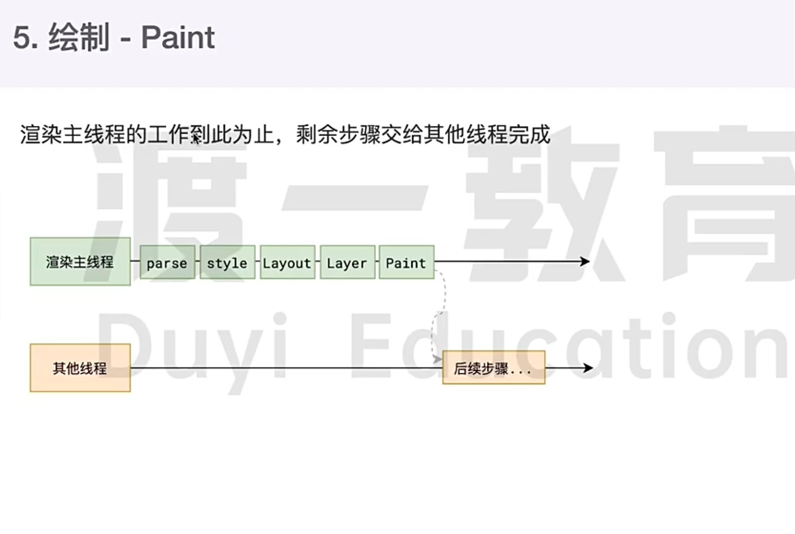
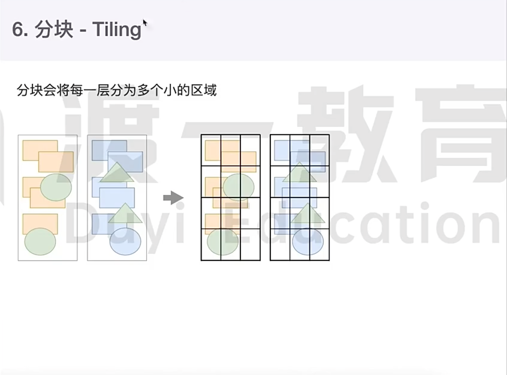
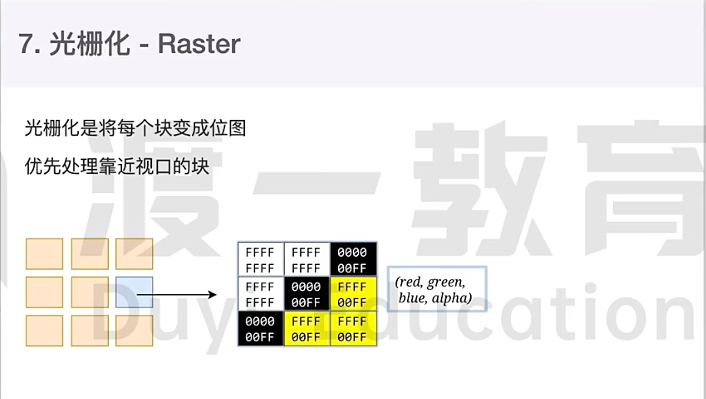
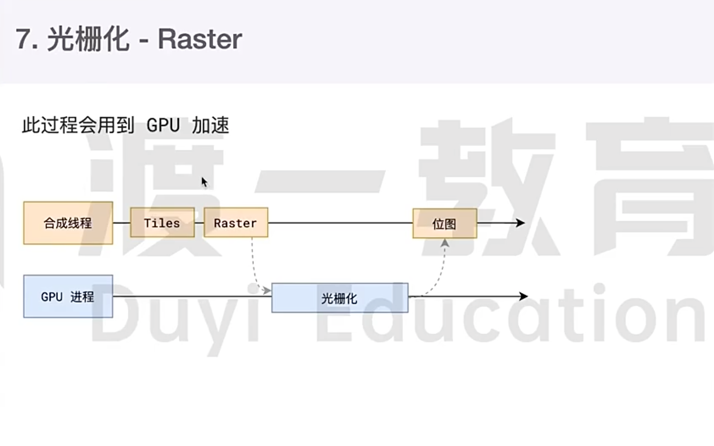
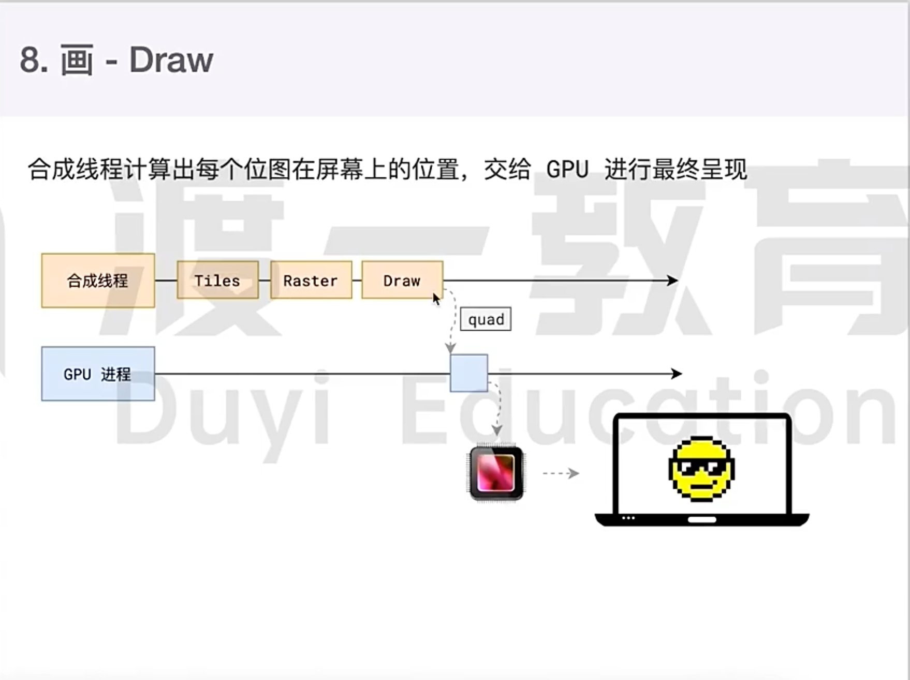

### 浏览器渲染原理
渲染定义(render): html字符串 -》像素信息

### 渲染时间点

网络: 拿HTML
渲染: 浏览器页面呈现

### 渲染流水线

1、解析HTML(Parse HTML)
Domcument Object Model: 文档对象模型,树形结构
CSS Object Model: CSS样式对象模型,树形结构

2、样式计算(Recalculate Style)

3、布局(Layout)
head、meta等标签没有在页面呈现的原因: 浏览器默认样式 display: none;

a、内容必须在行盒中
b、行盒和块盒不能相邻

4、分层(Layer)

5、绘制(Paint)
定义: 为每一层生成如何绘制的指令

6、分块(Tilling)

分块的工作是交给多个线程同时进行的

7、光栅化(Raster)
定义: 将每个块变成位图,优先处理靠近视口的块
此过程会用到GPU加速

8、画(Draw)
合成线程计算出每个位图在屏幕上的位置,交给GPU进行最终呈现

### reflow(重新排版)
reflow的本质是重新计算layout树
当进行了会影响布局树的操作后,需要重新计算布局树,会引发layout.
为了避免连续的多次操作导致布局树反复计算,浏览器会合并这些操作,当js代码全部完成后再进行统一计算.所以,改动属性造成的reflow是异步完成的
也同样因为如此,当js获取布局属性时,就可能造成无法获取到最新的布局信息
浏览器在反复权衡下,最终决定获取属性立即reflow

### repaint(重新绘制)
repaint本质就是重新根据分层信息计算了绘制指令
当改动了可见样式后,就需要重新计算,会引发repaint
由于元素的布局信息也属于可见样式,所以reflow一定会引起repaint

### transform效率高的原因
因为transform既不会影响布局也不会影响绘制指令,它影响的只是渲染流程的最后一个draw阶段
由于draw阶段在合成线程中,所以transform的变化几乎不会影响渲染主线程,反之,渲染主线程无论如何忙碌,也不会影响transform的变化