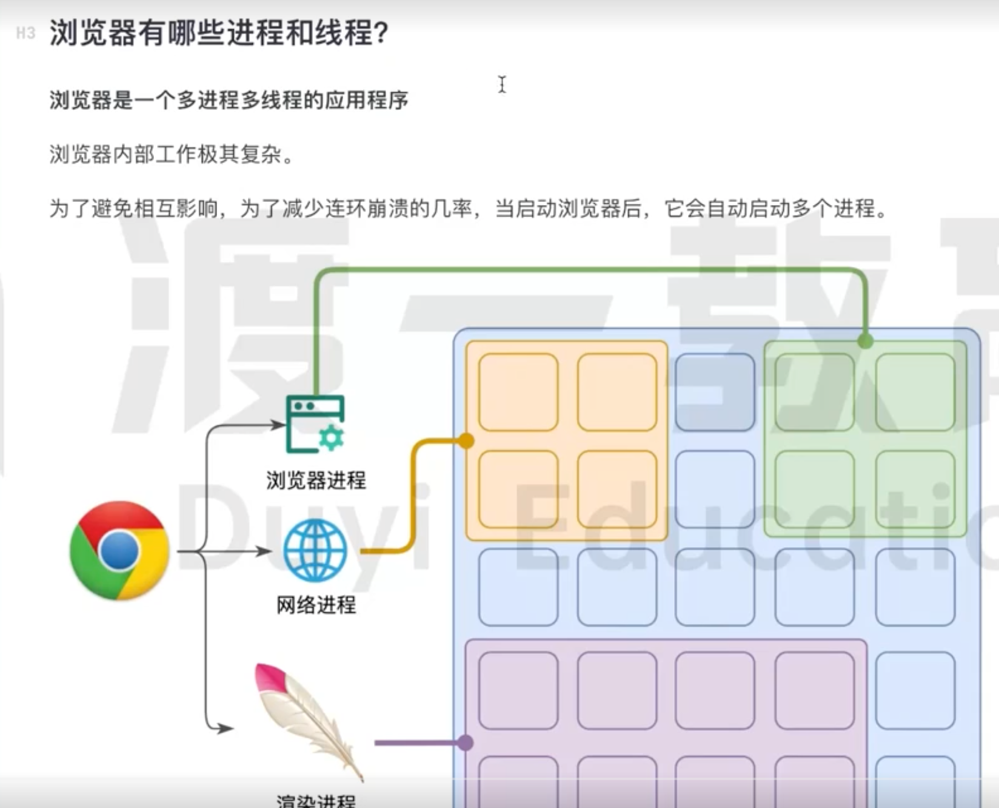
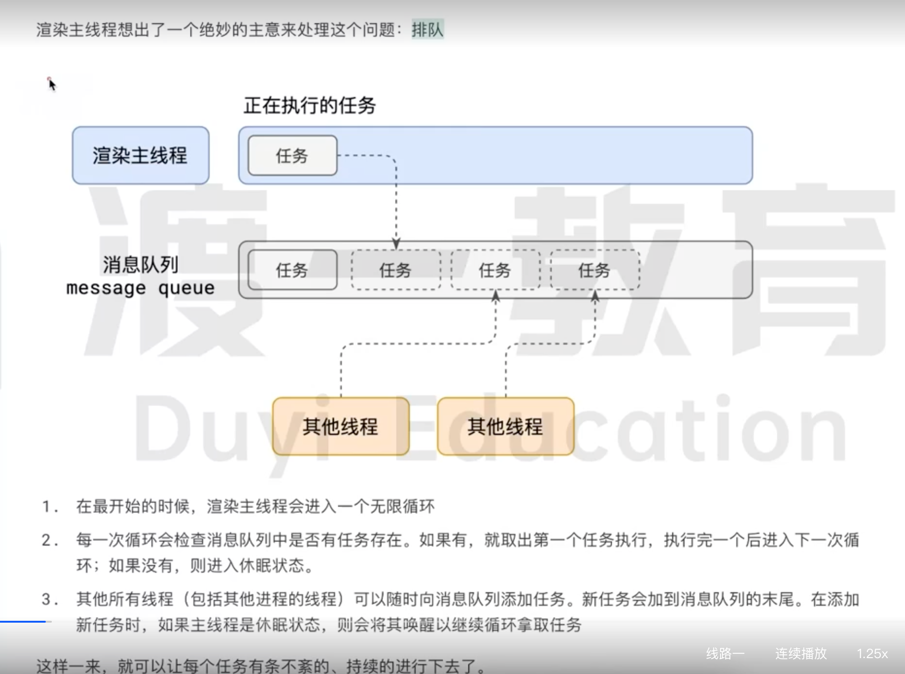
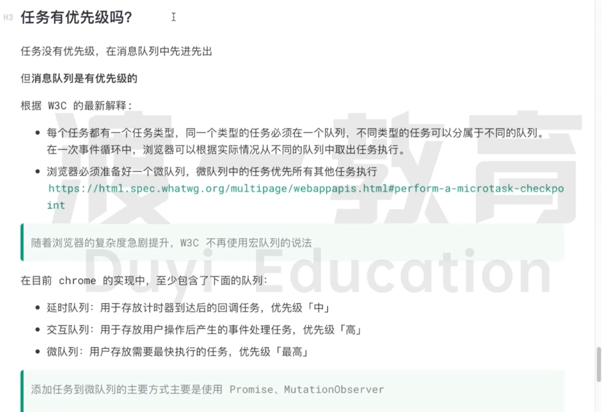
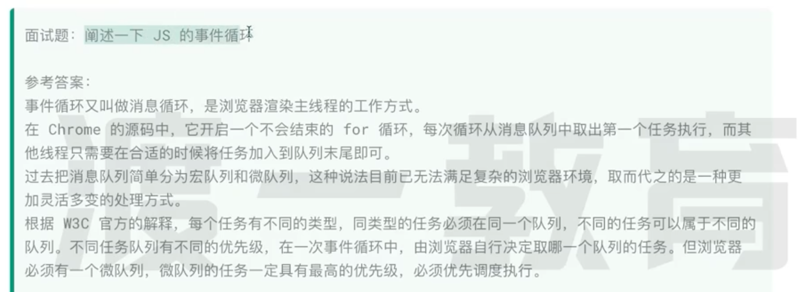
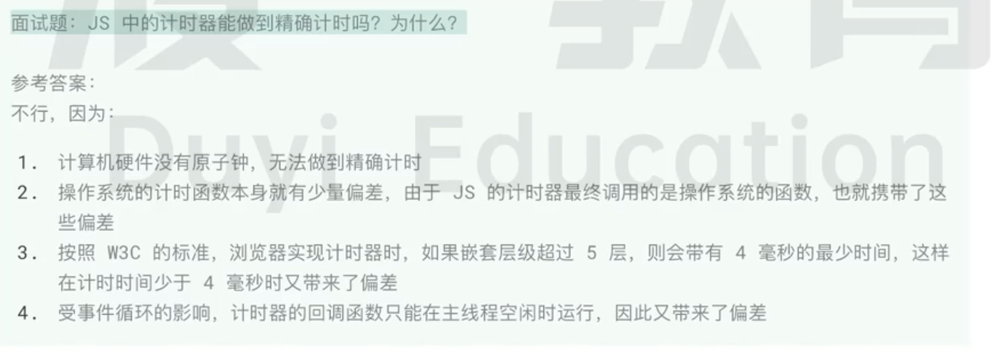

### 进程
定义: 程序运行需要有它自己专属的内存空间,可以把这块内存空间简单的理解为进程
每个应用至少有一个进程,进程之间相互独立,即使要通信,也需要双方同意

### 线程
定义: 运行程序的代码,运行代码的程序称为线程
一个进程至少有一个线程,所以在进程开启后会自动创建一个线程来运行代码,该线程称为主线程
如果程序需要同时执行多块代码,主线程就会启动更多的线程来执行代码,所以一个进程中可以包含多个线程

### 浏览器的进程和线程
浏览器是一个多进程多线程的应用程序
浏览内部工作极其复杂,为了避免相互影响,为了减少连环崩溃的几率,当启动浏览器后,它会自动启动多个进程
其中主要的进程有:
1、浏览器进程
主要负责界面交互、用户交互、子进程管理等.浏览器进程内部会启动多个线程处理不同的任务
2、网络进程
负责加载网络资源,网络进程内部会启动多个线程来处理不同的网络任务
3、渲染进程(重点)
渲染进程启动后,会开启一个渲染主线程,主线程负责执行HTML、CSS、JS代码
默认情况下,浏览器会为每个标签页开启一个新的渲染进程,以保证不同的标签页之间不相互影响

### 渲染主线程工作流程
渲染主线程是浏览器中最繁忙的线程,需要它处理的任务包括但不限于:
1、解析HTML
2、解析CSS
3、计算样式
4、布局
5、处理图层
6、每秒把页面画60次(FPS-帧率)
7、执行全局JS代码
8、执行事件处理函数
9、执行计时器的回调函数
....

### 事件循环(消息循环)
1、在最开始的时候,渲染主线程会进入一个无限循环
2、每一次循环会检查消息队列中是否有任务存在,如果有,就取出第一个任务执行,执行完一个后进入下一次循环;如果没有,则进入休眠状态
3、其它所有线程(包括其它进程的线程)可以随时向消息队列添加任务,新任务会加到消息队列的末尾,在添加新任务时,如果主线程是休眠状态,则会将其唤醒一集序循环拿取人物
4、这样一来,就可以让每个人物都有条不紊、持续的进行下去

### 异步
定义: 代码在执行过程中,会遇到一些无法立即处理的任务,浏览器选择异步来解决这个问题
例如: setTimeout、setInterval、XHR、Fetch、adEventListener
如何理解jsd的异步:
Js是一门单线程的语言,因为它运行在浏览器的渲染主线程中,而渲染主线程只有一个
而渲染主线程承担着诸多的工作,渲染页面、执行JS都在其中运行
如果使用同步的方式,就极有可能导致主线程产生阻塞,从而导致消息队列中的很多其它任务无法得到执行
这样一来,一方面会导致繁忙的主线程白白的消耗时间,另一方面导致页面无法及时更新,给用户造成卡死现象
所以浏览器采用异步的方式来避免,具体做法是当某些任务发生时,比如计时器、网络、事件监听,主线程将任务交给其他线程
去处理,自身立即结束任务的执行,转而执行后续代码,当其他线程完成时,将事先传递的回调函数包装成任务,加入消息队列的末尾排队,等待主线程调度执行
在这种异步模式下,浏览器永不阻塞,从而最大限度保证了单线程的流畅运行

### 任务优先级
定义: 任务是没有优先级,在消息队列中先进先出,单消息队列是有优先级的
目前Chrome实现中,至少包含了下面的队列:
延时队列: 用于存放计时器到达后的回调任务,优先级为中
交互队列: 用于存放用户操作后产生的事件处理任务,优先级为高
微队列: 用户存放需要最快执行的任务,优先级为最高

### JS的事件循环

### JS中计时器能否做到精确计时

### 总结
单线程是异步产生的原因
事件循环是异步的实现方式