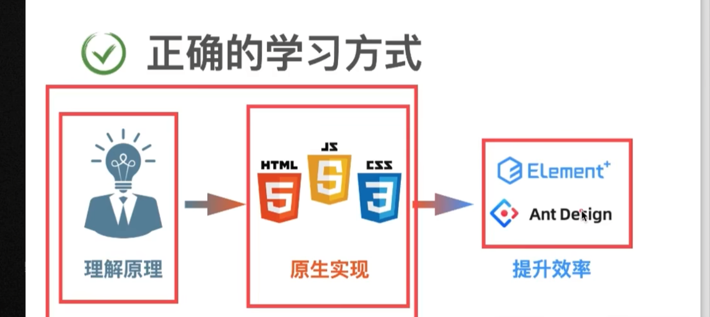
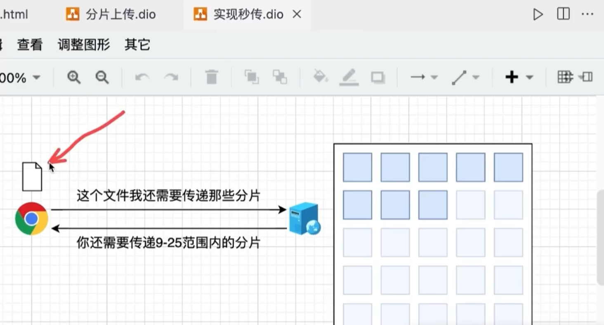

### 错误的学习方式
1、学习各种场景, 会导致学习量巨大
2、学习现成的第三方库, 会导致难以满足定制化需求、难以调试bug、学习量仍然不小

### 正确的学习方式
1、理解原理
2、原生实现
3、提升效率

### 文件上传的核心逻辑
客户端(样式、交互逻辑、运算) -》网络协议(http、消息格式、传输方式)-> 服务器(存储、安全、访问控制)

### 普通单文件上传
Content-Type格式: multipart/form-data;

### 拖拽上传

### base64格式文件上传
Content-Type格式: application/json

### 二进制格式文件上传
Content-Type格式: application/octet-stream

### 裁剪上传原理
1、如何实现本地预览
2、如何实现图像的部分上传

### 大文件分片上传

### 实现文件秒传

# 文件上传总结
1、浏览器端: 界面+交互
2、服务端: 存储+访问控制