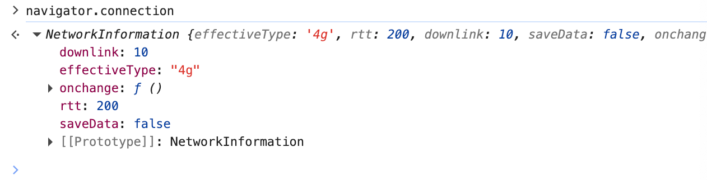

# Wen API定义
限制在浏览器环境中的函数/接口
示例: DOM、Event

### Intersection Observer API (交叉视口监听 API)
```
const ob = new IntersectionObserver(
    (entries) => {
        // todo
    }, 
    {
        threshold: 0
    }
)

const imgs = document.querySelectorAll('img[data-src]')
imgs.forEnach(img => {
    ob.observe(img)
})
```

### Page Visibility API (页面可见 API)
IE浏览器: hidden -> msHidden visibilityChange = msvisibilitychange
Chrome浏览器: hidden msvisibilitychange
```
// 实现浏览器兼容性处理
let hidden, visibilitychange;
if (typeof document.hidden !== 'undefined') {
    hidden = 'hidden'
    visibilitychange = 'visibilitychange'
} else if (typeof document.msHidden !== 'undefined') {
    hidden = 'msHidden'
    visibilitychange = 'msvisibilitychange'
} else if (typeof document.webkitHidden !== 'undefined') {
    hidden = 'webkitHidden'
    visibilitychange = 'webkitvisibilitychange'
}
```

### Web Animation API (web动画 API)
```
ball.animate(
    [
        {
            transform: `translate(${initX}px, ${initY}px) rotate(${deg}deg)`,
            easing: 'ease-out'
        },
        {
            transform: `translate(${initX}px, ${initY}px) rotate(${deg}deg) scaleX(1.5)`,
            offset: 0.6
        },
        {
            transform: `translate(${x}px, ${y}px) rotate(${deg}deg) scaleX(1.5)`,
            offset: 0.8
        },
        {
            transform: `translate(${x}px, ${y}px) rotate(${deg}deg)`
        }
    ],
    {
        duration: 1000,
        fill: 'forwards',
        easing: 'linear'
    }
)
```

### 网络检测 API

```
navigator.connection
网络状态: effectivetype
延迟: rtt
带宽: downlink

navigator.onLine: 是否在线
// 网络在线监听事件
window.addEventListener('online' ,function() {})
// 网络离线监听事件
window.addEventListener('offline' ,function() {})
// 网络状态发生改变监听事件
navigator.connection.addEventListener('change' ,function() {})
```

### 拖拽 API
```
<!-- ondragstart 事件在用户开始拖动元素或选择的文本时触发 -->
container.ondragstart = function (e) {}
<!-- ondragover 事件在可拖动元素或选取的文本正在拖动到放置目标时触发 -->
container.ondragover = function (e) {}
<!-- ondragenter 事件在拖动的元素或选择的文本进入到有效的放置目标时触发 -->
container.ondragenter = function (e) {}
<!-- ondrop 事件在可拖动元素或选取的文本放置在目标区域时触发 -->
 container.ondrop = function (e) {}
```


### Audio API (音频 API)
音频上下文: AudioContext

### 自动播放策略

### Clipboard API
```
// 生成新的剪切板内容
navigator.clipboard.writeText('HELLO WORLD')
```
